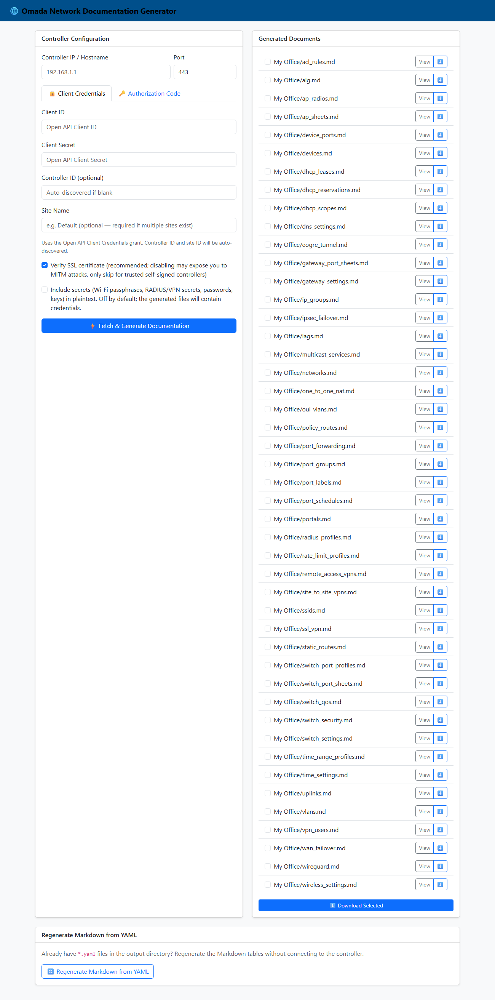

# omada_network

[](https://github.com/t3knoid/omada_network/actions/workflows/build.yml)
[](https://github.com/t3knoid/omada_network/actions/workflows/release.yml)

A Python application that uses the **Omada Open API** (Northbound API) to
extract network configuration data into YAML files (source of truth) and
generate Markdown documentation tables.

Use it to document a site, review changes over time (the YAML diffs cleanly),
check a configuration before and after an upgrade, or keep a reference copy
of the settings before migrating or replacing hardware. It is **read-only**:
nothing on the controller is changed. See [Practical use](#practical-use).

It can be run from a **CLI** (suited to scripts and CI) or a **web UI**. It
supports both official Open API authentication modes:

- **Client Credentials Mode** — direct token exchange with Client ID + Secret
- **Authorization Code Mode** — three-step flow with user credentials

## Features

The tool exports **46 resource types**. Each one is written to `docs/<site>/<resource>.yaml`, which holds the raw API data and is the source of truth, and `docs/<site>/<resource>.md`, which holds formatted tables (a summary table, and for many resources one detail section per item). IDs are resolved to names and numeric codes to labels. Credentials are redacted unless you ask for them (see [Secrets](#secrets)). For the API endpoints behind each resource, see the [API reference](api_reference.md#resource-index).

### Devices & switching

| Resource | File | Contents |
| --- | --- | --- |
| Devices | `devices` | Adopted devices: type, model, MAC, IP, status, firmware |
| Device Ports | `device_ports` | Every switch and gateway port: label, connection, type, operation, profile, native network, plus **per-port overrides** that differ from the assigned profile |
| PoE & Port Schedules | `port_schedules` | PoE and port on/off schedules and the switch ports they cover |
| Switch Port Profiles | `switch_port_profiles` | Summary table plus every property of each profile (VLANs, PoE, 802.1X, QoS, storm control, STP, …) |
| Link Aggregation (LAGs) | `lags` | LAG groups: static vs. LACP, member ports, link state, M-LAG groups, hash algorithm |
| Switch Settings | `switch_settings` | Management VLAN, jumbo frames, STP / loopback-detection coverage, IGMP snooping, LLDP, VLAN interfaces, RPVST |
| Uplinks & Stacks | `uplinks` | Uplink and downlink ports, stack members and stack ports, and a **remapping checklist** for model changes |
| Switch Port Sheets | `switch_port_sheets` | One printable sheet per switch: every port's VLANs, PoE, speed, LAG, connected device, settings to apply by hand, port-bound rules, and whether it must carry over to a replacement |
| Switch Security | `switch_security` | Switch 802.1X and MAC-based auth, DHCP snooping and ARP detection (with selected ports per switch), IP-MAC binding |
| OUI-Based VLANs | `oui_vlans` | Rules that place devices by vendor OUI into a VLAN / priority, with their target ports, and the OUI profiles |
| Switch QoS | `switch_qos` | QoS mode, rules (match, queue, DSCP remark, target ports), DSCP-to-queue and queue scheduler mappings |
| Switch Port Labels | `port_labels` | Port label definitions |

### LAN & addressing

| Resource | File | Contents |
| --- | --- | --- |
| Networks | `networks` | LAN networks |
| VLANs | `vlans` | VLANs |
| DHCP Scopes | `dhcp_scopes` | DHCP service per network: server or relay, pools, lease time, DNS / domain, options, guard |
| DHCP Reservations | `dhcp_reservations` | Static reservations with descriptions and per-reservation options |
| DHCP Leases | `dhcp_leases` | Current leases across all DHCP servers (runtime snapshot) |

### Security groups & ACLs

| Resource | File | Contents |
| --- | --- | --- |
| IP Groups | `ip_groups` | IP groups |
| Port Groups | `port_groups` | IP-port groups |
| ACL Rules | `acl_rules` | Gateway, switch, and EAP ACLs with network and group names resolved |

### Gateway, WAN & routing

| Resource | File | Contents |
| --- | --- | --- |
| Gateway Settings | `gateway_settings` | WAN port configuration |
| WAN Failover & Load Balancing | `wan_failover` | Load balancing weights, link backup / failover rules, health-check interval, WAN health snapshot |
| Gateway Port Sheets | `gateway_port_sheets` | One sheet per gateway: each port's WAN / LAN capability and mode, WAN connection, LAN networks, PVID, speed, mirroring, connected switches, and a checklist of every site setting that references a gateway port |
| Port Forwarding | `port_forwarding` | Port forwarding rules |
| One-to-One NAT | `one_to_one_nat` | One-to-one NAT rules |
| ALG | `alg` | Application Layer Gateway settings |
| Static Routes | `static_routes` | Gateway and switch static routes: destinations, next hop, interface, metric / distance |
| Policy Routes | `policy_routes` | Policy routes in evaluation order with WAN binding and backup interface |

### Site services

| Resource | File | Contents |
| --- | --- | --- |
| DNS | `dns_settings` | DNS proxy (DNSSEC / DoH / DoT / override), DNS cache, local DNS records, Dynamic DNS |
| Time & NTP | `time_settings` | Time zone, NTP servers, daylight saving time |
| Multicast, Bonjour & UPnP | `multicast_services` | IGMP / MLD proxy, IPTV, UPnP, Bonjour (mDNS) rules and profiles, multicast snooping |

### Wireless

| Resource | File | Contents |
| --- | --- | --- |
| SSIDs | `ssids` | Full SSID settings (security, RADIUS, VLAN, rate limits, schedule, band steering, …) and per-AP overrides |
| RADIUS Profiles | `radius_profiles` | RADIUS authentication / accounting servers |
| Guest Portals | `portals` | Guest portals: authentication method, bound SSIDs, timeouts, landing page |
| Schedules (Time Range Profiles) | `time_range_profiles` | Schedules (time ranges) referenced by SSIDs, PoE, and failover |
| Rate Limit Profiles | `rate_limit_profiles` | Client rate limit profiles |
| Wireless Site Settings | `wireless_settings` | Site band steering, roaming, mesh, multicast rate limit |
| AP Radio Settings | `ap_radios` | Per-AP radio settings: channel, width, Tx power, wireless mode |
| Access Point Sheets | `ap_sheets` | One sheet per AP: bands, IP setting, management VLAN / SSID, uplink, radios, SSID overrides, LED / LLDP / power saving / load balancing, and wall-plate LAN ports with their VLANs and PoE |

### VPN

| Resource | File | Contents |
| --- | --- | --- |
| Site-to-Site VPNs | `site_to_site_vpns` | IPsec tunnels: peers, subnets, IKE / IPsec proposals, authentication |
| Remote-Access VPNs | `remote_access_vpns` | L2TP / PPTP / IPsec / OpenVPN servers and clients |
| WireGuard VPN | `wireguard` | WireGuard interfaces and peers |
| VPN Users | `vpn_users` | VPN user accounts referenced by the servers |
| SSL VPN Server | `ssl_vpn` | SSL VPN server settings, user groups, users, resources |
| EoGRE Tunnel | `eogre_tunnel` | EoGRE tunnel settings |
| IPsec Failover | `ipsec_failover` | IPsec failover groups |

---

## Web Front End



---

## Project Structure

```text
omada_network/
├── .github/
│   └── workflows/
│       ├── build.yml              # CI build workflow
│       └── release.yml            # Release workflow
├── docs/                          # Generated YAML + Markdown output
├── omada/
│   ├── api/
│   │   └── openapi_client.py      # Official Open API (Northbound) client
│   ├── exporters/
│   │   ├── markdown_generator.py  # Generates Markdown documentation
│   │   └── yaml_exporter.py       # Writes resources to YAML files
│   ├── web/
│   │   ├── app.py                 # Flask application factory
│   │   └── templates/
│   │       ├── doc_view.html      # Document viewer
│   │       └── index.html         # Main configuration form
│   ├── logging_config.py          # Logging configuration
│   ├── redaction.py               # Credential redaction for exports
│   ├── registry.py                # Resource registry (single place to add a resource)
│   └── service.py                 # Orchestration service layer
├── tests/
│   ├── conftest.py                # Blocks real network access during tests
│   ├── test_cli.py
│   ├── test_exporters.py
│   ├── test_logging_config.py
│   ├── test_openapi_client.py
│   ├── test_redaction.py
│   ├── test_registry.py
│   ├── test_service.py
│   └── test_web.py
├── .dockerignore
├── ARCHITECTURE.md                # System design and extensibility guide
├── TESTS.md                       # Test suite inventory
├── api_reference.md               # Endpoints and output details per resource
├── cli.py                         # Click CLI entry-point
├── Dockerfile                     # Docker container definition
├── image.png                      # Web UI screenshot (this README)
├── pyproject.toml
├── requirements.txt
├── requirements-dev.txt
├── start_web.bat                  # Windows web UI launcher
└── start_web.sh                   # Linux/macOS web UI launcher
```

---

## Requirements

- Python 3.10+
- An Omada SDN Controller (v5.x / v6.x) with:
  - **Open API enabled** and a Client ID + Client Secret generated in the controller settings

---

## Installation

```bash
# Clone the repository
git clone https://github.com/t3knoid/omada_network.git
cd omada_network

# Install dependencies
pip install -r requirements.txt

# For development (includes test dependencies)
pip install -r requirements-dev.txt
```

---

## Docker

A Docker image lets you run the application without installing Python or any
dependencies on your host.

### Build

```bash
docker build -t omada_network .
```

### Run

By default the container starts the web UI on port 5000:

```bash
docker run -p 5000:5000 --name omada_network omada_network 
```

Open <http://localhost:5000> in your browser to access the web UI.

### Environment Variables

All `OMADA_*` environment variables are supported. Pass them with `-e`:

```bash
docker run -p 5000:5000 \
  -e OMADA_LOG_LEVEL=DEBUG \
  -e FLASK_SECRET_KEY=my-secret-key \
  --name omada_network \
  omada_network
```

### Persisting Output

Mount a host directory to `/app/docs` to keep generated files on your host:

```bash
docker run -p 5000:5000 \
  -v "$(pwd)/docs:/app/docs" \
  --name omada_network \
  omada_network
```

### Running CLI Commands

You can run any CLI command instead of the default web server:

```bash
# Fetch and generate documentation
docker run \
  -e OMADA_CONTROLLER=192.168.1.1 \
  -e OMADA_CLIENT_ID=YOUR_CLIENT_ID \
  -e OMADA_CLIENT_SECRET=YOUR_CLIENT_SECRET \
  -v "$(pwd)/docs:/app/docs" \
  omada_network python cli.py fetch

# Regenerate Markdown from existing YAML
docker run \
  -v "$(pwd)/docs:/app/docs" \
  omada_network python cli.py generate --input-dir docs
```

### Logs

Application logs are written to **stdout/stderr** by default and are visible
with:

```bash
docker logs <container>
```

To also enable file logging inside the container, set `OMADA_LOG_FILE`:

```bash
docker run -p 5000:5000 \
  -e OMADA_LOG_FILE=/app/logs/omada_network.log \
  -v "$(pwd)/logs:/app/logs" \
  --name omada_network \
  omada_network
```

---

## Configuration

The application supports two authentication modes, both using the official Omada Open API (Northbound API):

For **Controller IP / hostname**, enter an address that this application can
reach. It does not have to be a numeric IP: if you open the controller UI at
`https://omada.example.com:8043`, use `omada.example.com` as the controller
value. The API port is configured separately and defaults to `443`; the UI
port in the browser address may be different. If you specifically need the
numeric IP for an OC200, open the network where the controller is connected
in the Omada UI, select **Clients**, and search for **OC200**. Use the IP
address shown for that client. For a software controller, check the host
machine's network settings; a router's DHCP client list is another option for
hardware controllers.

### Generate Open API credentials

1. Sign in to the Omada SDN Controller with an administrator account.
2. In **Global View**, open **Settings → Platform Integration → Open API**. Menu labels may vary slightly between controller versions.
3. Enable the Open API if it is not already enabled.
4. Choose **Create New Application**, enter a name for this integration, and create the application.
5. Copy the generated **Client ID** and **Client Secret** and store them securely. Do not commit the secret to source control.

These are API application credentials, not your controller username and password. The username and password are only needed for Authorization Code Mode.

### Option A — Client Credentials Mode (simplest)

Direct token exchange using the Client ID and Client Secret only. No
controller login credentials are needed.

**Prerequisites:** Enable the Open API and generate credentials as described
in [Generate Open API credentials](#generate-open-api-credentials).

| Parameter | CLI Option | Environment Variable | Default |
| --- | --- | --- | --- |
| Controller IP / hostname | `--controller` | `OMADA_CONTROLLER` | |
| Management port | `--port` | `OMADA_PORT` | `443` |
| Controller ID | `--controller-id` | `OMADA_CONTROLLER_ID` | auto-discovered |
| Client ID | `--client-id` | `OMADA_CLIENT_ID` | |
| Client Secret | `--client-secret` | `OMADA_CLIENT_SECRET` | |
| Site name | `--site-name` | `OMADA_SITE_NAME` | |
| Output directory | `--output-dir` | `OMADA_OUTPUT_DIR` | `docs` |
| Verify SSL cert | `--verify-ssl` | `OMADA_VERIFY_SSL` | off |
| Include secrets (plaintext) | `--include-secrets` | `OMADA_INCLUDE_SECRETS` | off |

```bash
python cli.py fetch \
  --controller 192.168.1.1 \
  --client-id YOUR_CLIENT_ID \
  --client-secret YOUR_CLIENT_SECRET

# Multi-site controller — select by name
python cli.py fetch \
  --controller 192.168.1.1 \
  --client-id YOUR_CLIENT_ID \
  --client-secret YOUR_CLIENT_SECRET \
  --site-name "My Office"

# Using environment variables
export OMADA_CONTROLLER=192.168.1.1
export OMADA_CLIENT_ID=YOUR_CLIENT_ID
export OMADA_CLIENT_SECRET=YOUR_CLIENT_SECRET
python cli.py fetch
```

### Option B — Authorization Code Mode

Three-step OAuth2 flow that additionally requires controller admin
credentials (username and password). Use this mode when your Open API
configuration requires user-level authorization.

| Parameter | CLI Option | Environment Variable | Default |
| --- | --- | --- | --- |
| Controller IP / hostname | `--controller` | `OMADA_CONTROLLER` | |
| Management port | `--port` | `OMADA_PORT` | `443` |
| Controller ID | `--controller-id` | `OMADA_CONTROLLER_ID` | auto-discovered |
| Client ID | `--client-id` | `OMADA_CLIENT_ID` | |
| Client Secret | `--client-secret` | `OMADA_CLIENT_SECRET` | |
| Username | `--username` | `OMADA_USERNAME` | |
| Password | `--password` | `OMADA_PASSWORD` | |
| Site name | `--site-name` | `OMADA_SITE_NAME` | |
| Output directory | `--output-dir` | `OMADA_OUTPUT_DIR` | `docs` |
| Verify SSL cert | `--verify-ssl` | `OMADA_VERIFY_SSL` | off |
| Include secrets (plaintext) | `--include-secrets` | `OMADA_INCLUDE_SECRETS` | off |

```bash
python cli.py fetch \
  --controller 192.168.1.1 \
  --client-id YOUR_CLIENT_ID \
  --client-secret YOUR_CLIENT_SECRET \
  --username admin \
  --password secret
```

> **Note:** When `--username` and `--password` are provided alongside the
> client credentials, the tool automatically uses Authorization Code mode.
> Without them, it defaults to Client Credentials mode.

### Logging

By default the application logs to the console (``stderr``) at the ``INFO``
level.  You can optionally enable **file logging** with automatic rotation,
and customise the log level and format via CLI options or environment
variables.

| Parameter | CLI Option | Environment Variable | Default |
| --- | --- | --- | --- |
| Log level | `--log-level` | `OMADA_LOG_LEVEL` | `INFO` |
| Log file path | `--log-file` | `OMADA_LOG_FILE` | *(disabled)* |
| Log format | — | `OMADA_LOG_FORMAT` | `%(levelname)s %(message)s` |

When a log file path is provided, the application uses a
`RotatingFileHandler` (5 MB per file, 3 backups) so log files never grow
without bound.  The log directory is created automatically if it does not
exist.  **Log file paths are relative to the current working directory**
(the directory from which you run the command).

```bash
# Enable file logging — writes to ./logs/omada_network.log relative to CWD
python cli.py --log-file logs/omada_network.log fetch ...

# Change log level to DEBUG
python cli.py --log-level DEBUG fetch ...

# Using environment variables
export OMADA_LOG_LEVEL=DEBUG
export OMADA_LOG_FILE=logs/omada_network.log
python cli.py fetch ...
```

> **Note:** The `--verbose` / `-v` flag is a shortcut for `--log-level DEBUG`.
> Console logging to ``stderr`` is always active regardless of file logging
> settings.
>
> The `start_web` convenience scripts enable file logging to
> `omada_network.log` in the current working directory (not the default
> `logs/` subdirectory).  These scripts are intended for local development
> only.

### Auto-discovery

Both modes automatically discover:

1. **Controller ID** — `GET /api/info` → `result.omadacId` (unless
   `--controller-id` is explicitly provided)
2. **Site ID** — via the Open API sites endpoint. For controllers with
   multiple sites, pass `--site-name` to select by display name
   (case-insensitive).

---

## CLI Usage

### `fetch` — pull from the controller and generate docs

```bash
# Client Credentials mode (simplest)
python cli.py fetch \
  --controller 192.168.1.1 \
  --client-id YOUR_CLIENT_ID \
  --client-secret YOUR_CLIENT_SECRET

# Authorization Code mode (add --username / --password)
python cli.py fetch \
  --controller 192.168.1.1 \
  --client-id YOUR_CLIENT_ID \
  --client-secret YOUR_CLIENT_SECRET \
  --username admin \
  --password secret

# Multi-site controller — select by name
python cli.py fetch \
  --controller 192.168.1.1 \
  --client-id YOUR_CLIENT_ID \
  --client-secret YOUR_CLIENT_SECRET \
  --site-name "My Office"

# Same using environment variables (ideal for CI/CD)
export OMADA_CONTROLLER=192.168.1.1
export OMADA_CLIENT_ID=YOUR_CLIENT_ID
export OMADA_CLIENT_SECRET=YOUR_CLIENT_SECRET
python cli.py fetch

# Enable SSL verification (off by default)
python cli.py fetch --verify-ssl ...

# Include credentials in plaintext, e.g. for a restorable backup (off by default)
python cli.py fetch --include-secrets ...
```

> **`--include-secrets`** exports Wi-Fi passphrases, RADIUS / VPN shared
> secrets, portal and VPN user passwords, WireGuard keys, PPPoE passwords and
> other credentials as their real values instead of `<redacted>`, in both YAML
> and Markdown. A warning is printed, and every Markdown file holding a
> plaintext credential gets a warning banner below its title (also when
> regenerated from YAML). Treat the output directory as sensitive.

### `generate` — regenerate Markdown from existing YAML (no API credentials)

```bash
# Regenerate all Markdown files from the YAML source-of-truth in docs/
python cli.py generate --input-dir docs

# Write Markdown to a different directory
python cli.py generate --input-dir docs --output-dir site/docs

# Regenerate from and write to docs/My Office/
python cli.py generate --input-dir docs --site-name "My Office"

# Via environment variable
OMADA_OUTPUT_DIR=docs python cli.py generate
```

### `serve` — start the web server

```bash
python cli.py serve --host 0.0.0.0 --port 5000
# Open http://127.0.0.1:5000 in your browser
```

| Option | Default | Description |
| --- | --- | --- |
| `--host` | `127.0.0.1` | Address to bind |
| `--port` | `5000` | Port to listen on |
| `--output-dir` | `$OMADA_OUTPUT_DIR` or `docs` | Where generated files are written and listed |
| `--debug` | off | Flask debug mode (local development only) |

### `diagnose` — check what each endpoint returns

```bash
python cli.py diagnose --controller 192.168.1.1 \
  --client-id YOUR_CLIENT_ID --client-secret YOUR_CLIENT_SECRET
```

Authenticates like `fetch` and calls every resource's fetcher. For each
resource it prints the record count and the field names of the first record,
or the error. It never prints field values. Use it when an export comes out
empty or a field you expect is missing. It accepts the same connection
options as `fetch`.

### Global options

`--log-level` (`debug`, `info`, `warning`, `error`), `-v` / `--verbose`
(same as `--log-level debug`) and `--log-file` go **before** the
subcommand, e.g. `python cli.py -v fetch …`. Running `python cli.py` with no
subcommand runs `fetch` using the `OMADA_*` environment variables.

---

## Web UI

```bash
python cli.py serve
# Open http://127.0.0.1:5000 in your browser
```

The configuration form offers two authentication tabs:

- **🔒 Client Credentials** — enter your Client ID and Client Secret for a
  direct token exchange (simplest mode).
- **🔑 Authorization Code** — enter Client ID, Client Secret, plus your
  controller username and password for the three-step OAuth2 flow.

> **Note on SSL verification defaults:** The web UI defaults to SSL
> verification **enabled** (checkbox checked) to encourage secure connections
> in the browser-based workflow. The CLI defaults to SSL verification **off**
> (`--verify-ssl` must be passed explicitly) because most self-signed
> controller setups are managed from the command line. This difference is
> intentional — set `OMADA_VERIFY_SSL=true` or pass `--verify-ssl` in the CLI
> if your controller has a valid (non-self-signed) certificate.

Below the tabs:

- **Verify SSL certificate**: checked by default (see the note above).
- **Include secrets**: unchecked on every visit. When ticked, credentials are
  exported in plaintext, as with `--include-secrets` on the CLI, and a warning
  is shown after the run. See [Secrets](#secrets).

Click **⚡ Fetch & Generate Documentation** to pull data from the controller
and create the YAML + Markdown files. Non-secret form values (controller,
port, IDs, site name) are remembered in the session. Passwords and secrets
are never stored.

The **Generated Documents** panel lists every Markdown file under the output
directory as `Site/file.md`:

- **View** renders the file in the browser, with navigation between documents.
- **⬇** downloads that file.
- Tick several files and click **⬇ Download Selected** to get them as a ZIP
  archive (`omada_docs.zip`). A single ticked file downloads as-is.

**🔄 Regenerate Markdown from YAML** rebuilds the Markdown from the existing
YAML files without connecting to the controller. It uses the site from the
last fetch, or the site name in the form.

### Persistent sessions (`FLASK_SECRET_KEY`)

By default the web server generates a random secret key on startup.  This
means browser sessions — and the CSRF tokens embedded in every form — are
invalidated every time the server restarts.  For deployments that need
persistent sessions, set the `FLASK_SECRET_KEY` environment variable to a
stable, secret value:

```bash
export FLASK_SECRET_KEY="$(python -c 'import secrets; print(secrets.token_hex(32))')"
python cli.py serve
```

### Air-gapped networks

The web UI loads **Bootstrap 5** and **GitHub Markdown CSS** from public CDNs
(`cdn.jsdelivr.net` and `cdnjs.cloudflare.com`).  On networks without
internet access the UI will still function but will render without styling.

If you need fully offline operation, download the three assets listed below
and place them in a local directory (e.g. `omada/web/static/`):

| Asset | CDN URL |
| --- | --- |
| Bootstrap 5.3.3 CSS | `https://cdn.jsdelivr.net/npm/bootstrap@5.3.3/dist/css/bootstrap.min.css` |
| Bootstrap 5.3.3 JS | `https://cdn.jsdelivr.net/npm/bootstrap@5.3.3/dist/js/bootstrap.bundle.min.js` |
| GitHub Markdown CSS 5.5.1 | `https://cdnjs.cloudflare.com/ajax/libs/github-markdown-css/5.5.1/github-markdown-light.min.css` |

Then update the `<link>` and `<script>` tags in both
`omada/web/templates/index.html` and `omada/web/templates/doc_view.html` to
point to the local files instead of the CDN URLs. For example, replace:

```html
<link rel="stylesheet"
      href="https://cdn.jsdelivr.net/npm/bootstrap@5.3.3/dist/css/bootstrap.min.css">
```

with:

```html
<link rel="stylesheet"
      href="{{ url_for('static', filename='bootstrap.min.css') }}">
```

Repeat for the Bootstrap JS bundle and the GitHub Markdown CSS file.

---

## Output

After a successful run, YAML source files and Markdown documentation are
written under `docs/<site_name>/`:

> **Note:** The `docs/` directory is excluded from version control via
> `.gitignore`.  Generated output is local to each environment — run
> `python cli.py fetch` to populate it.

### Secrets

> **Secrets are not exported by default.** Every resource is passed through
> `omada/redaction.py` before anything is written: any non-empty string whose
> field name looks like a credential (password, pwd, secret, token, security
> key, pre-shared key, private key) is replaced with `<redacted>`. This covers
> Wi-Fi passphrases and per-AP override passwords, RADIUS shared secrets, guest
> portal passwords, OAuth secrets and SMS tokens, VPN pre-shared keys and user /
> client passwords, SSL VPN user passwords, WireGuard private / preshared keys,
> and WAN credentials such as PPPoE passwords. The YAML records only that a
> secret is configured, and the Markdown shows `Configured` / `Not set`. Public
> keys, usernames, and account / certificate identifiers are kept as
> authentication references. To export the real values (for a restorable
> backup), pass `--include-secrets` or tick **Include secrets** in the web UI.

```text
docs/
└── My Office/                ← one directory per site
    ├── acl_rules.yaml        ← source of truth (raw API data)
    ├── acl_rules.md          ← Markdown tables generated from it
    ├── devices.yaml
    ├── devices.md
    └── …                     ← one .yaml / .md pair per resource (see Features)
```

`generate` (or **Regenerate** in the web UI) rebuilds every `.md` from the
`.yaml` files, so you can edit or version the YAML and regenerate the docs
offline.

### Example – DHCP Reservations Markdown

```markdown
# DHCP Reservations

| Network | IP Address | MAC Address | Name | Description | Options | Status | Server |
| --- | --- | --- | --- | --- | --- | --- | --- |
| LAN | 192.168.1.50 | AA-BB-CC-DD-EE-FF | printer | Office printer |  | Enabled | Gateway |
| LAN | 192.168.1.120 | 11-22-33-44-55-66 | nas |  | Option 66: 192.168.1.10 | Enabled | Gateway |
```

Resources with more settings than fit in one table, such as port profiles,
SSIDs, DHCP scopes, VPN tunnels and switch settings, add a detail section per
item below the summary table (Category / Setting / Value).

---

## Practical use

The tool takes a written "picture" of a site. Run `fetch`, read or share the
Markdown, keep the YAML. These are the common ways to use it.

### Document a site

Run `fetch` once and open the output in the web UI (or any Markdown viewer).
Good places to start:

| Question | File |
| --- | --- |
| What hardware is there, on which firmware? | `devices.md` |
| Which networks / VLANs exist and how is DHCP set up? | `networks.md`, `dhcp_scopes.md`, `dhcp_reservations.md` |
| What is plugged into which switch port? | `device_ports.md`, `switch_port_sheets.md` |
| How do the switches, gateway and APs connect? | `uplinks.md` |
| What Wi-Fi is broadcast, with which security and VLAN? | `ssids.md` |
| What is open to the internet? | `port_forwarding.md`, `one_to_one_nat.md`, `acl_rules.md` |
| How does remote access work? | `remote_access_vpns.md`, `wireguard.md`, `ssl_vpn.md` |

Secrets are redacted by default, so the output can be handed to a colleague,
a consultant or a support ticket. It still contains IP addresses, MAC
addresses, device names and network layout, so share it on a need-to-know
basis. In the web UI, tick the files you need and use **Download Selected**
to get a ZIP.

### Track changes over time

The YAML is the raw API data written with sorted keys, so a diff shows what
was changed rather than what moved. Write the output to a folder
under version control and commit after each run:

```bash
# One-time setup: a separate repository for the exports
# (this repository's docs/ is gitignored on purpose)
git init ~/omada-config

# Each run
python cli.py fetch --output-dir ~/omada-config
cd ~/omada-config && git add -A && git commit -m "Omada export $(date +%F)"
git log --stat          # which resources changed, and when
git diff HEAD~1         # exactly what changed since the last run
```

Some resources are runtime snapshots and change on most runs: DHCP leases,
device status and the WAN health table. Ignore those when looking for
configuration changes, or review the diff file by file.

To run it on a schedule, put the credentials in the environment rather than on
the command line, then call the same two steps from cron (Linux / macOS) or
Task Scheduler (Windows):

```bash
# /etc/cron.d/omada-export — every night at 02:00
0 2 * * * omada . /etc/omada-export.env && cd /opt/omada_network && python cli.py fetch --output-dir /srv/omada-config && cd /srv/omada-config && git add -A && git commit -qm "Omada export $(date +\%F)"
```

where `/etc/omada-export.env` (readable only by that user) exports
`OMADA_CONTROLLER`, `OMADA_CLIENT_ID`, `OMADA_CLIENT_SECRET` and, for a
multi-site controller, `OMADA_SITE_NAME`. Use one run per site.

### Before and after a change

Before a firmware upgrade, a controller migration, or a reconfiguration, run
`fetch` and keep the result. Run it again afterwards and compare. With the
git setup above, that is `git diff`. Without it, copy the folder first and
compare the two copies:

```bash
python cli.py fetch --output-dir before
# … make the change …
python cli.py fetch --output-dir after
diff -r "before/My Office" "after/My Office"
```

A setting that disappeared or reset to its default after an upgrade shows up
as a removed or changed line in the YAML.

### Review the configuration

The Markdown resolves IDs to names and codes to labels, which makes it
practical to read the configuration end to end instead of clicking through the
controller. Things worth checking:

- **Exposure:** every port forward and one-to-one NAT rule, and whether it is
  still needed (`port_forwarding.md`, `one_to_one_nat.md`).
- **Wi-Fi security:** SSIDs still on WPA2 / open, guest networks without
  isolation, SSIDs on the wrong VLAN (`ssids.md`, `portals.md`).
- **Segmentation:** which networks the ACLs actually separate
  (`acl_rules.md`, `networks.md`).
- **Leftovers:** unused port profiles, IP groups, VPN users and DHCP
  reservations for devices that are gone.
- **Consistency:** switches with different management VLAN, STP or LLDP
  settings (`switch_settings.md`), ports with settings that differ from their
  profile (`device_ports.md`).

### Keep a complete written record

`--include-secrets` (or **Include secrets** in the web UI) also writes Wi-Fi
passphrases, VPN keys, RADIUS secrets and other credentials in plaintext. Use
it when you need a record you could rebuild the site from by hand, for
example before resetting a controller. Store that output encrypted or offline
and do not commit it to a shared repository.

This tool only reads. It cannot push a configuration back. To restore a
controller, use the controller's own backup (**Settings → Maintenance →
Backup & Restore** in the Omada UI; labels vary slightly between versions). The export is the readable companion to
that backup: it tells you what the backup contains and what to check after
restoring it.

### Replace hardware

Omada can move settings from an old device to a new one of the same kind. It
cannot decide where things go when the new model has a different number or
layout of ports. For that, the export has one printable sheet per device:
what each port does, what is plugged in, which settings were set by hand, and
which site rules point at that specific port. Run a fresh `fetch` just before
the swap and keep the output.

#### Replacing a switch

Omada can transfer settings to a replacement device. When the new switch has
**fewer ports** (or a different port layout), use `switch_port_sheets.md` to
reconfigure it by hand:

1. Run a fresh `fetch` just before the swap, so the sheets reflect the
   current configuration. Keep that output.
2. In the summary table, check **Must Carry Over** (and its SFP / PoE counts)
   against the new switch's ports.
3. In the old switch's section, each port shows its profile, native /
   untagged / tagged VLANs, PoE, speed, LAG, what's connected to it, and the
   settings that **differ from the profile** (which a profile alone won't
   restore). **Carry Over** says why a port matters (connected, uplink,
   downlink, LAG member, custom settings, named); `No (unused, default)`
   ports can be dropped.
4. Assign the same profiles on the new switch, apply the listed manual
   settings, rebuild LAGs (see `lags.md`), and re-patch the uplink and
   downlinks (see the remapping checklist in `uplinks.md`).
5. **Port-Bound Rules** lists site rules that name this specific port: DHCP
   snooping and ARP detection selections (`switch_security.md`), OUI-based
   VLAN rules (`oui_vlans.md`) and QoS rules (`switch_qos.md`). Those rules
   reference the old switch's ports, so re-select the new ports in each one.

Site-wide settings (networks, profiles, ACLs, DHCP, …) stay in the controller
and aren't affected by the swap.

#### Replacing a gateway

On a gateway, many site settings point at a **WAN port by ID** (for example
`1_<uuid>`, where the prefix is the port number): port forwarding, one-to-one
NAT, routes, VPNs, failover, Dynamic DNS, UPnP / IGMP / IPTV, IP-MAC binding.
LAN networks are tied to gateway LAN ports the same way. A model with a
different set of WAN-capable ports changes those IDs, and settings pointing at
a missing port stop working. Use `gateway_port_sheets.md`:

1. Run a fresh `fetch` just before the swap.
2. The gateway's section lists each port's **Capability** (WAN only, WAN or
   LAN, LAN only) and current **Mode**. Check that the new model has a port
   for every WAN and every connected LAN port.
3. **WAN Connection** has what you need to re-create the internet
   connection: type, static address, PPPoE user, MTU, VLAN tag, cloned MAC,
   IPv6. Passwords show as `configured`; see [Secrets](#secrets) to export
   them.
4. **Connected switches** shows which switch port uplinks to the gateway, and
   **Connected To** which gateway port it uses (when the controller reports
   it).
5. Work through the **Port reference checklist**. Every row names a setting,
   in the file where it lives, that references a gateway port. Re-select the
   right port in each one on the new gateway.

#### Replacing an access point

SSIDs and most wireless settings are site-wide and follow automatically. The
settings in `ap_sheets.md` belong to one AP and are lost when you swap it
for a different model. Rows marked **Carry Over** were set by hand:

- **Radios:** fixed channels, widths and Tx power, per band. A model with
  different bands (for example tri-band or 6 GHz) needs new choices.
- **IP address and management VLAN:** static IP, DHCP reservation or
  fallback IP, custom management VLAN, management SSID.
- **SSID overrides** on this AP (SSID off, name, VLAN, password).
- **Uplink:** the switch port the AP is plugged into, uplink port selection,
  LAG, P2P bridge.
- **LAN ports** on wall-plate and multi-port APs: VLAN, PoE out, rate limits,
  and what's connected.
- **General:** LED, LLDP, power saving, load balancing, U-APSD, where not
  left on the site defaults.

Each AP needs about 15 API calls, so on a large site this resource takes a
while to fetch.

### When an export looks wrong

If a file is empty or a setting you expect is missing, run `diagnose`. It
shows, per resource, how many records the controller returned and which
fields they have, without printing any values. A resource that errors
usually means the controller version or the Open API application's
permissions don't cover that endpoint. Re-run with `-v` for the full API
log.

---

## Development

```bash
# Install dev dependencies
pip install -r requirements-dev.txt

# Run tests
python -m pytest tests/ -v

# Run a specific test module
python -m pytest tests/test_openapi_client.py -v

# Lint (CI fails only on syntax errors / undefined names; style is reported)
flake8 . --count --select=E9,F63,F7,F82 --show-source --statistics
flake8 . --max-line-length=120

# Build package
pip install build
python -m build
```

Tests never touch the network: `tests/conftest.py` blocks real HTTP traffic,
so every API call must be mocked. See [TESTS.md](TESTS.md) for the full test
inventory.

### Adding a resource

Add a `get_*` method to `omada/api/openapi_client.py` and a
`ResourceDefinition` (with its row formatter) to `omada/registry.py`. The CLI,
web UI, YAML export, Markdown generation and `diagnose` all pick it up from the
registry. Add the mock return value to the service fixtures in
`tests/test_service.py` and `tests/test_openapi_client.py`, and document it
in `api_reference.md`. See [ARCHITECTURE.md](ARCHITECTURE.md#extensibility).

### CI/CD

This project uses GitHub Actions for continuous integration and deployment.

**Build Workflow** (`.github/workflows/build.yml`)

- Triggers on pull requests and pushes to `main`.
- Runs a matrix build across Python 3.10, 3.11, and 3.12.
- Installs dependencies, lints with flake8, runs tests, and builds the package.
- Uploads test results and build artifacts.

**Release Workflow** (`.github/workflows/release.yml`)

- Triggers on version tags (e.g. `v1.0.0`) or manual dispatch.
- Tags must use the format `vN.N.N` (e.g. `v1.0.0`, `v0.0.1`). Invalid
  formats will cause the workflow to fail with a clear error message.
- When using manual dispatch, the tag must already exist in the repository.
- Lints and runs the test suite, then builds and packages the project (sdist + wheel).
- Creates a GitHub Release with the built artifacts.
- Optionally publishes to PyPI when a `PYPI_API_TOKEN` secret is configured
  in a `pypi` environment.

### Architecture

See [ARCHITECTURE.md](ARCHITECTURE.md) for a comprehensive overview of the
system design, component details, data flows, and extensibility guide.

---

## License

MIT
